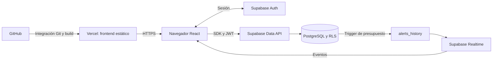

# Finanzas Personales

Aplicación web en la nube para registrar ingresos y gastos, consultar el balance de un período y controlar presupuestos. Proyecto de la **Entrega 1 del Taller ABP: Proyecto y Material Técnico (20%)**.

**[Abrir aplicación](https://personal-finance-taupe-psi.vercel.app/dashboard)** · **[Explorar sin cuenta](https://personal-finance-taupe-psi.vercel.app/explore/dashboard)** · **[Presentación PDF](docs/presentacion-proyecto.pdf)** · **[PowerPoint editable](docs/presentacion-proyecto.pptx)**


## Problema y solución

El registro disperso de ingresos y gastos dificulta conocer el saldo disponible y detectar excesos de presupuesto. Finanzas Personales centraliza esos movimientos en una interfaz web con categorías, gráficos y topes de gasto.

El caso se basa en el producto desarrollado. Su correspondencia con una situación específica del docente, la modalidad de trabajo y el plazo deben confirmarse según [el alcance académico](docs/ACTIVIDAD_ABP.md).

## Funcionalidades

- Autenticación, registro y recuperación de contraseña con Supabase Auth.
- Creación, edición, clonación y eliminación de transacciones.
- Categorías y presupuestos mensuales/anuales con vigencia opcional.
- Dashboard por mes, categoría o rango de fechas.
- Alertas de presupuesto mediante PostgreSQL y Supabase Realtime.
- Modo exploración con datos de ejemplo en memoria, sin guardar cambios en la nube.
- Diseño adaptable con cuatro temas: **Vidrio, Menta, Aurora y Profundo**.
- Formato monetario seleccionable. Cambiar la moneda no convierte los importes.

La solución no realiza pagos ni se conecta a bancos. Tampoco ejecuta modelos de IA. El [análisis de IA y ética](docs/IA_Y_ETICA.md) explica los fundamentos pertinentes, la asistencia utilizada y una aplicación futura propuesta, sin presentarla como implementada.

## Arquitectura en la nube



El navegador consulta Supabase directamente. Vercel publica los archivos estáticos de `dist`; las migraciones se aplican por separado en Supabase. [Arquitectura completa, modelo de datos y límites](docs/ARQUITECTURA.md).

| Capa | Tecnologías reales del repositorio |
| --- | --- |
| Interfaz | React 18, TypeScript, Vite, Tailwind CSS |
| Estado y consultas | Contextos y hooks propios de React, eventos locales de actualización |
| Formularios | React Hook Form, Zod y resolvers |
| Backend administrado | Supabase Auth, PostgreSQL, Data API y Realtime |
| Visualización | Recharts, Lucide y Sonner |
| Entrega | GitHub, GitHub Actions y Vercel |

## Instalación local

Requisitos: Git, Node.js 22 con npm y un proyecto Supabase del equipo.

```bash
git clone https://github.com/bryangallegobetancur/Personal-finance.git
cd Personal-finance
npm ci
```

Copiar `.env.example` a `.env` y completar `VITE_SUPABASE_URL` y `VITE_SUPABASE_ANON_KEY` con la URL y la clave pública del proyecto Supabase. No usar claves administrativas. Las variables `VITE_*` quedan visibles en el navegador.

En un proyecto Supabase nuevo, ejecutar en orden:

1. [`0001_init.sql`](supabase/migrations/0001_init.sql).
2. [`0002_add_budget_dates.sql`](supabase/migrations/0002_add_budget_dates.sql).
3. [`0003_relax_date_constraint.sql`](supabase/migrations/0003_relax_date_constraint.sql).

Configurar en Supabase las URLs permitidas de autenticación y recuperación antes de probarlas.

```bash
npm run dev
```

Vite muestra la dirección local, habitualmente `http://localhost:5173`. [Instrucciones completas de instalación y despliegue](docs/DESPLIEGUE.md).

## Despliegue

El frontend está publicado en **[personal-finance-taupe-psi.vercel.app](https://personal-finance-taupe-psi.vercel.app)**. Vercel está conectado al repositorio, según confirmó su responsable.

Configuración: preset **Vite**, instalación `npm ci`, build `npm run build`, salida `dist` y las dos variables públicas de Supabase. `vercel.json` permite recargar rutas internas de la SPA. La ruta `/dashboard` requiere sesión; para evaluar la interfaz sin cuenta, usar `/explore/dashboard`.

El repositorio público y el acceso web se verificaron el **11 de octubre de 2026**. La persistencia, la recuperación de contraseña y el aislamiento entre cuentas requieren completar las pruebas de integración de [Evidencias](docs/EVIDENCIAS.md).

## Calidad y evidencias

```bash
npm run lint
npm run typecheck
npm run build
npm run preview
```

El workflow [Calidad del proyecto](.github/workflows/ci.yml) ejecuta lint y build en GitHub Actions. El estado de una ejecución remota debe consultarse en la pestaña Actions; la presencia del archivo no demuestra que haya pasado.

Las capturas públicas utilizan datos de demostración. La [matriz de verificación](docs/EVIDENCIAS.md) distingue comprobaciones realizadas de pruebas pendientes. No se afirma una mejora cuantitativa del ahorro o del tiempo de gestión, ya que no se ha realizado un estudio con usuarios.

## Organización del repositorio

```text
Personal-finance/
├── .github/workflows/ci.yml   # Comprobaciones automáticas
├── docs/                     # Entrega académica y documentación técnica
│   ├── presentacion-proyecto.pdf
│   ├── presentacion-proyecto.pptx
│   ├── ACTIVIDAD_ABP.md
│   ├── ARQUITECTURA.md
│   ├── DESPLIEGUE.md
│   ├── EVIDENCIAS.md
│   ├── IA_Y_ETICA.md
│   ├── evidencias/            # Capturas de la demo pública
│   └── diseno/               # Diseño vigente y antecedentes
├── public/                   # Logo y recursos estáticos
├── src/
│   ├── components/           # UI y componentes por dominio
│   ├── contexts/             # Sesión, temas, moneda y exploración
│   ├── hooks/                # Lecturas y escrituras con hooks propios
│   ├── lib/                  # Supabase, autenticación y utilidades
│   ├── pages/                # Pantallas
│   ├── routes/               # Guards de navegación
│   ├── schemas/              # Validación de formularios
│   └── types/                # Tipos del dominio
├── supabase/migrations/     # Migraciones 0001, 0002 y 0003
├── .env.example             # Plantilla sin credenciales
├── .eslintrc.cjs
├── vercel.json
└── LICENSE.txt
```

## Material para la entrega

La carpeta [docs](docs/README.md) contiene la presentación de **una diapositiva en estilo Vidrio**, el análisis del problema, los diagramas y el soporte técnico. El [guion de exposición](docs/EVIDENCIAS.md#guion-de-demostracion) acompaña la diapositiva.

En Canvas se debe entregar únicamente este enlace:

**https://github.com/bryangallegobetancur/Personal-finance**

La entrega en Canvas corresponde al estudiante y no se ha realizado desde este repositorio.

## Autores y licencia

Autores identificados en la documentación original:

- Bryan Stiven Gallego Betancur.
- John Alejandro Alvarez Muñoz.
- Daniel Santiago Naranjo Rodriguez.

**[Proyecto UCN IIA](https://github.com/bryangallegobetancur/Personal-finance)**  
© 2026 · [Bryan Gallego](https://github.com/bryangallegobetancur)

Esta obra está bajo la licencia **[Creative Commons Atribución-NoComercial-CompartirIgual 4.0 Internacional (CC BY-NC-SA 4.0)](https://creativecommons.org/licenses/by-nc-sa/4.0/deed.es)**.

<a href="https://creativecommons.org/licenses/by-nc-sa/4.0/deed.es">
  
  
  
  
</a>

Archivo de licencia [LICENSE.txt](LICENSE.txt).
