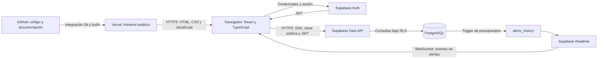
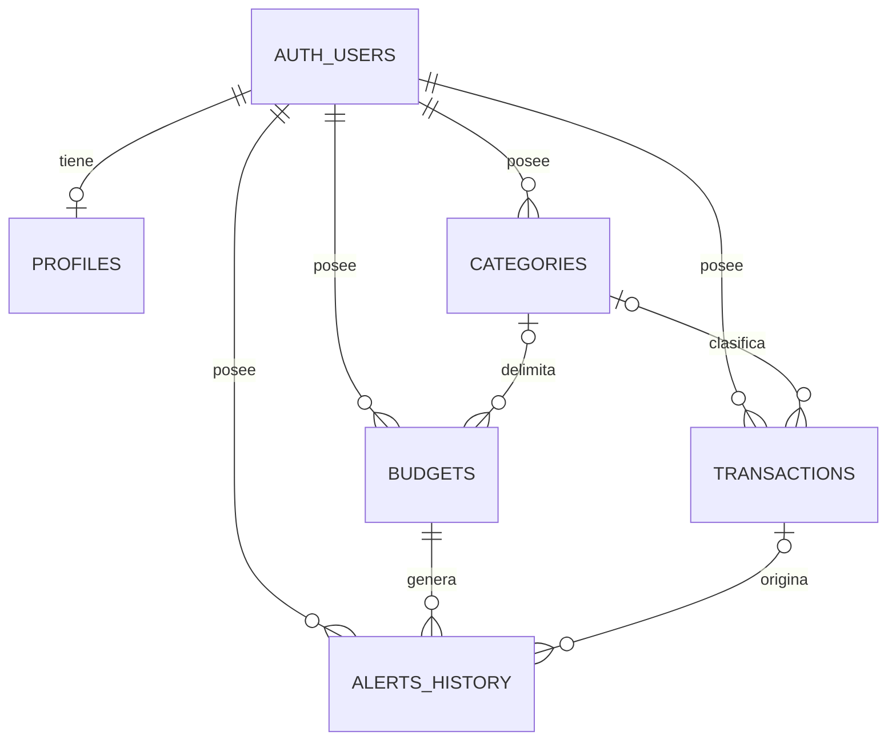

# Arquitectura tecnológica en la nube

## Vista de despliegue

La solución es una SPA React con servicios administrados de Supabase. Vercel entrega los archivos de `dist`; el navegador se comunica directamente con Supabase. No existe un servidor Express, una API propia ni funciones de IA en este repositorio.

La integración Vercel/GitHub fue confirmada por el responsable del proyecto. La URL pública y su modo exploración se comprobaron desde el navegador. La configuración del proyecto Supabase y la ejecución de sus políticas no se han auditado desde su consola.

## Responsabilidades

| Capa | Implementación | Responsabilidad |
| --- | --- | --- |
| Presentación | `src/pages`, `src/components`, Tailwind, Recharts | Formularios, vistas y gráficos |
| Estado | Contextos React y hooks propios | Sesión, temas, moneda, exploración y estado de las consultas |
| Coordinación | `emitRefetch` / `onRefetch` en `src/lib/utils.ts` | Notificar cambios y recargar consultas |
| Validación | `src/schemas`, React Hook Form y Zod | Validar campos antes de escribir |
| Acceso a datos | `src/lib/supabase.ts`, hooks de queries/mutations | Consultar Supabase y gestionar errores |
| Identidad | Supabase Auth | Cuentas y sesiones |
| Persistencia | PostgreSQL, migraciones y RLS | Tablas, restricciones y acceso por propietario |
| Notificaciones | Trigger SQL, Realtime y Sonner | Registrar y mostrar excesos de presupuesto |
| Entrega | GitHub y Vercel | Versionado, revisión y publicación del frontend |

El proyecto **no utiliza TanStack Query**. Los nombres de carpetas `queries` y `mutations` describen hooks propios basados en React.

## Modelo de datos

| Entidad | Campos principales y reglas |
| --- | --- |
| `profiles` | `id` enlazado a `auth.users`, nombre y marcas de tiempo |
| `categories` | Propietario, nombre y tipo; unicidad por usuario/nombre/tipo |
| `transactions` | Importe positivo, fecha, descripción, tipo y categoría opcional |
| `budgets` | Importe positivo, periodicidad, categoría opcional y vigencia opcional |
| `alerts_history` | Usuario, presupuesto, transacción opcional e importe excedido |

Eliminar una categoría con transacciones está restringido. Borrar una categoría elimina sus presupuestos asociados. Eliminar un presupuesto elimina sus alertas; eliminar una transacción deja `transaction_id` nulo en las alertas. Borrar el usuario elimina sus registros relacionados. Estos comportamientos están definidos en SQL.

## Flujos principales

1. **Acceso:** Supabase Auth entrega la sesión; los guards del router protegen las vistas y PostgreSQL aplica las políticas RLS.
2. **Registro:** el formulario valida con Zod; el hook escribe en Supabase con el usuario autenticado y emite eventos locales de actualización.
3. **Resumen:** `useDashboardSummary` consulta movimientos del período y calcula totales en el navegador. El balance es ingresos menos gastos.
4. **Alerta:** después de insertar o actualizar un gasto, `check_budget_exceeded` busca presupuestos aplicables y suma los gastos del período. Si hay exceso, intenta registrar una alerta. Realtime comunica la inserción al cliente.
5. **Exploración:** `ExploreContext` mantiene datos de ejemplo en memoria. Sus cambios se pierden al recargar y no acreditan persistencia cloud.

## Decisiones y límites

- El frontend estático y el backend administrado reducen la infraestructura que el equipo debe operar.
- La clave pública de Supabase se incluye en el cliente por diseño. La protección de filas depende de las políticas RLS, no de ocultar esa clave. [Referencia oficial](https://supabase.com/docs/guides/database/postgres/row-level-security).
- Los filtros de la interfaz y las rutas privadas no sustituyen los controles de base de datos.
- La migración `0002` añade vigencia de presupuestos: `start_date` inclusiva y `end_date` exclusiva. Los totales comparados siguen siendo del mes o año completo de la transacción.
- La migración `0003` permite un margen de un día en la restricción SQL de fecha. El frontend mantiene la validación de fechas futuras.
- La lista de transacciones solicita hasta 100 registros y el historial hasta 50 alertas. El dashboard no implementa paginación de consultas: grandes volúmenes requieren revisar los límites de respuesta de Supabase.
- El control de alertas usa una consulta previa sobre `created_at`, sin una restricción única de presupuesto/período. No garantiza deduplicación bajo concurrencia o registros retroactivos.
- Las políticas verifican el propietario de cada fila. Debe probarse adicionalmente la propiedad de categorías y presupuestos referenciados mediante claves foráneas antes de afirmar aislamiento completo entre usuarios.
- El selector de moneda cambia formato y símbolo. Los importes no almacenan divisa por transacción y no se convierten.

## Seguridad y operación pendientes de validación

Usar dos cuentas de prueba para verificar lecturas y escrituras cruzadas, referencias a categorías ajenas y eventos Realtime. Revisar recuperación de contraseña y respaldos con el responsable de Supabase. No publicar `.env`, claves administrativas, JWT, correos reales ni movimientos personales en las evidencias.
