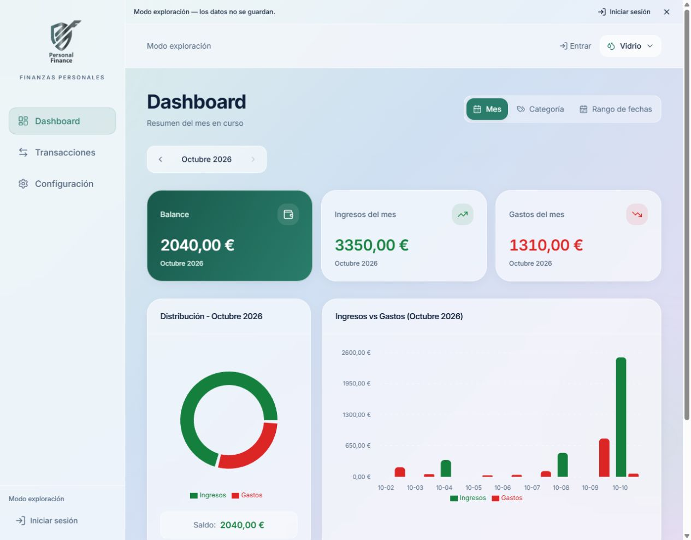
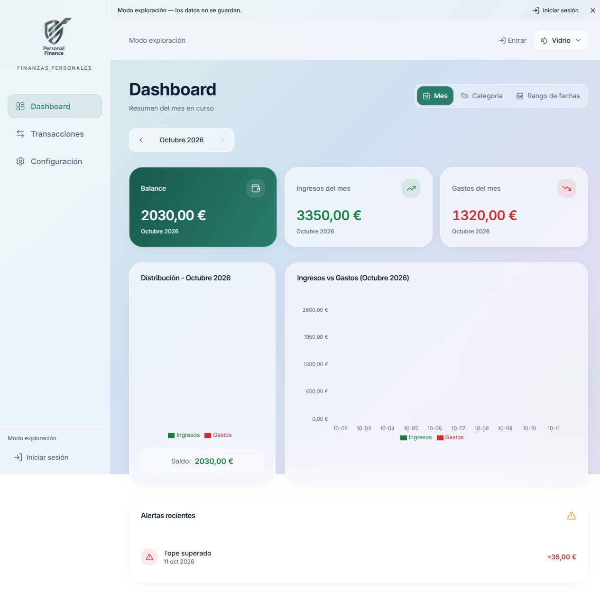

# Evidencias y verificación

Fecha de revisión: **11 de octubre de 2026**, zona horaria de referencia América/Bogotá.

## Entorno y alcance

Se revisó el código, se ejecutaron comprobaciones locales y se navegó la aplicación pública en Vercel. Las pruebas funcionales aquí registradas utilizaron **el modo exploración**. No se usaron cuentas reales, datos bancarios ni credenciales administrativas.

| Comprobación | Resultado observado | Límite de la evidencia |
| --- | --- | --- |
| Repositorio público | La API pública de GitHub reportó `private: false` y Git respondió sin autenticación | Verificar de nuevo antes de entregar |
| URL `/dashboard` sin sesión | Redirección a `/login` | Verifica navegación, no autorización de base de datos |
| Demo pública | Dashboard visible en `/explore/dashboard` | Datos de ejemplo en memoria |
| Creación de movimiento | Gasto de 10,00 EUR, descripción `Prueba ABP (datos de ejemplo)`, visible en la lista | Operación en memoria, sin persistencia en Supabase |
| Actualización del resumen | Ingresos 3350,00 EUR; gastos de 1310,00 a 1320,00 EUR; balance de 2040,00 a 2030,00 EUR | Resultado del conjunto de ejemplo en la fecha de la revisión |
| Reinicio de la demo | Recargar restablece los datos de ejemplo | No es pérdida de datos de una cuenta real |
| Interfaz | Vidrio público capturado; cuatro temas y adaptación móvil revisados durante la mejora visual | No equivale a auditoría completa de accesibilidad |
| `npm run lint` | Correcto con `.eslintrc.cjs` | Análisis estático de TypeScript/TSX y reglas de hooks |
| `npm run build` | Correcto; incluye comprobación TypeScript | Advertencia de bundle superior a 500 kB |
| Presentación | Ocho diapositivas en PPTX y PDF en `docs` | Material ejecutivo, ampliado por los documentos técnicos |

No hay una suite automatizada de integración o de extremo a extremo en este repositorio. El workflow de CI ejecuta lint y build; esas verificaciones no acreditan funcionamiento del backend cloud.

## Capturas

### Dashboard público con diseño Vidrio

URL: [demo pública](https://personal-finance-taupe-psi.vercel.app/explore/dashboard). Datos de ejemplo, no información financiera personal.

### Actualización después del gasto de prueba

El balance pasa a 2030,00 EUR al agregar el gasto de 10,00 EUR en el modo exploración.

## Pruebas de integración pendientes

Realizar en un proyecto de prueba administrado por el equipo. Registrar fecha, resultado y evidencia sin claves, correos reales o JWT.

| Prueba | Procedimiento | Resultado esperado |
| --- | --- | --- |
| Registro y sesión | Crear una cuenta de prueba, confirmar correo si aplica, entrar y salir | Sesión válida y rutas protegidas tras salir |
| Persistencia | Crear un movimiento autenticado y volver a entrar | El movimiento continúa disponible |
| Aislamiento | Usar cuentas A y B; consultar y modificar registros de A desde B | RLS impide acceso a filas de A |
| Referencias ajenas | Intentar asociar una categoría o presupuesto de A a registros de B | La base debe rechazar la relación; revisar y corregir si la prueba falla |
| Alertas | Crear un tope y registrar gastos que lo superen | Fila en `alerts_history` y notificación Realtime |
| Concurrencia y fechas pasadas | Repetir operaciones simultáneas o retroactivas que excedan un tope | Evaluar duplicados; la implementación actual no garantiza unicidad por período |
| Recuperación | Pedir enlace para un correo de prueba y completar el flujo | Redirección autorizada y nueva sesión válida |
| Despliegue desde Git | Verificar el commit en GitHub Actions y en Vercel | Build correcto y aplicación accesible con el último código |

## Guion de demostracion

Duración sugerida: 4 a 5 minutos, ajustable a lo que indique el docente.

1. Presentar el problema y el objetivo con la presentación.
2. Abrir la demo pública y señalar el aviso de datos no guardados.
3. Mostrar balance, ingresos, gastos y las vistas por categoría y rango.
4. Crear un gasto de ejemplo y observar la actualización del balance.
5. Mostrar categorías y presupuestos, explicando que el trigger y RLS pertenecen a Supabase.
6. Recorrer el diagrama GitHub, Vercel, navegador y Supabase. Aclarar que publicar el frontend no aplica las migraciones.
7. Explicar la ausencia de IA en ejecución, su uso como apoyo y los riesgos de una futura clasificación automática.
8. Cerrar con el repositorio, la documentación y las pruebas cloud pendientes, sin afirmar métricas de impacto no medidas.

## Resultado y límites

La evidencia demuestra un frontend desplegado, una demo funcional y una entrega técnica organizada. No demuestra ahorro económico, adopción por usuarios, disponibilidad garantizada ni aislamiento cloud auditado. Esos resultados exigirían mediciones y pruebas adicionales.
